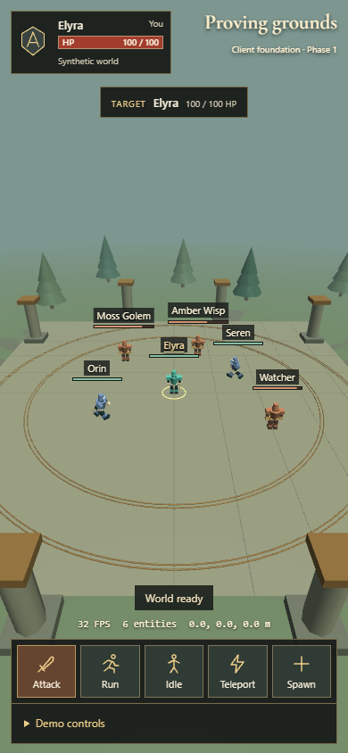

# L2 Browser Client — Phase 1

A standalone Babylon.js browser client with an editable courtyard and six synthetic characters. It demonstrates the rendering and world-data boundary for a later Interlude adapter. It does not connect to a game server.

The project starts from Babylon.js Editor v5's native **Vanilla** template. Its Vite entry points, `project.bjseditor`, native scene directory, official packing CLI, and scene-attached runtime script are retained. The original static environment is stored as editable resources; runtime TypeScript creates the dynamic characters.



## Run locally

Prerequisites:

- Node.js **22.12.0 or later** and a browser with WebGL support.
- **pnpm 10.32.1**, matching `packageManager` in `package.json`. Use pnpm for all dependency operations and retain `pnpm-lock.yaml`.
- Babylon.js Editor **5.5.3** only for desktop authoring. The browser demo does not need the Editor or an MCP server.

```sh
pnpm install
pnpm dev
```

Open **http://127.0.0.1:5173**. The dev command first exports the authored scene with the official Editor CLI. Port 5173 is fixed; the template's port 3000 was unavailable on the implementation machine because Windows rejected the bind with `EACCES`.

```sh
pnpm typecheck
pnpm build
pnpm serve
```

`pnpm build` exports the scene, runs strict TypeScript checking, and creates `dist/`. `pnpm serve` previews that build locally. No production deployment is configured.

The pinned stack is Babylon.js **9.27.1**, Editor runtime tools/CLI **5.5.3**, TypeScript **7.0.2**, Vite **7.3.7**, Vitest **5.1.0**, and Playwright **1.64.1**. The exact dependency graph is in `pnpm-lock.yaml`.

## Explore the demo

The first scene contains exactly one local player (**Elyra**), two simulated remote players (**Orin** and **Seren**), and three monsters (**Moss Golem**, **Amber Wisp**, and **Watcher**). Remote players receive synthetic movement updates; monsters alternate idle and cosmetic attack states. Floating names and health bars follow every character.

| Control | Behavior |
| --- | --- |
| Click/tap a character or its name | Select it; show the ground ring and target details. |
| Click/tap the courtyard ground | Clear the selection and move Elyra to that point. |
| Right mouse drag / touch drag | Orbit the authored camera. |
| Mouse wheel / two-finger pinch | Zoom within the authored limits. |
| **Attack**, **Run**, **Idle** | Set Elyra's animation. Run demonstrates the pose in place; ground input supplies movement. |
| **Teleport** | Snap Elyra between fixed positions without interpolating across the courtyard. |
| **Spawn** | Add a synthetic sentinel through the adapter. |
| **Demo controls → Despawn target** | Remove a selected remote player or monster, its label, and its selection. |
| **Demo controls → Pause / Resume** | Pause/resume synthetic simulation. Camera controls, presentation animation, and manual demo commands remain usable. |
| **Demo controls → Missing model** | Spawn a sentinel with an intentionally unavailable model; retain its animated procedural fallback. |

FPS, entity count, and interpolated local coordinates are displayed above the action bar. Health values are synthetic presentation data; attacks do not calculate damage. Reloading restores the initial six entities.

The interface follows the requested classic fantasy-game layout: health at upper left, actions along the bottom, bronze borders, and compact target information. The primary compact viewport is 390 × 844. Geometry and icons are original; no pixels or proprietary assets were copied from the supplied visual reference.

## Test

Install the Playwright browser once after installing dependencies:

```sh
pnpm test:setup
```

On Linux, if system browser dependencies are missing:

```sh
pnpm exec playwright install --with-deps chromium
```

Then run:

```sh
pnpm test
```

This runs both Vitest and Playwright. Individual commands are `pnpm test:unit` and `pnpm test:e2e`. Playwright starts and stops its own `pnpm dev` server on port 5173; stop a manually running dev server before the browser suite. The Chromium configuration enables software WebGL for environments without a GPU. Failure traces are retained under `test-results/`.

The suites exercise adapter state and lifecycle, time boundaries and teleport snapping, procedural and model animation drivers, asset validation/fallback, visible entity removal, camera input/limits, mouse targeting, compact touch controls, diagnostics, and browser errors. The deliberately missing-model test allows only its specific expected HTTP 404 console message; uncaught exceptions and other error messages fail the suite. Browser coverage is Chromium; other browsers and physical mobile devices require separate verification.

The unit suite also runs the real official scene packer on editable fixtures and emulates the Editor's script compiler settings. These checks catch export and bundling regressions; desktop Editor operation remains a separate check. See [docs/VERIFICATION.md](docs/VERIFICATION.md) for recorded outcomes.

## Edit the environment

1. Install [Babylon.js Editor 5.5.3](https://github.com/BabylonJS/Editor/releases/tag/v5.5.3), then choose **Import project** in its dashboard and select the root `project.bjseditor`.
2. Open `assets/example.scene`. Edit the ground, static props, lights, or **World camera**. Keep that camera's name and `ArcRotateCamera` type, and keep the **Courtyard ground** name used by movement picking. Keep `scripts/world.ts` attached to the scene.
3. Save, close, and reopen the scene to check persistence. Use **Play current scene**, or **Play project as-is** to run the project's `pnpm dev` command.
4. Run `pnpm dev` again after a saved environment edit to repack the same resources for the browser. Do not edit `public/scene/` or `src/scripts.ts`: they are generated by `pnpm generate`.

This scene uses **meters**, whereas the stock template and some Editor import defaults use centimeters. Check imported model scale and keep camera/navigation settings consistent. Static resources were serialized once into the native editable format during implementation; no scene-construction generator runs during dev/build, so saved edits are not replaced by a generated scene.

**Desktop verification remains outstanding:** no installed Editor was available for import/edit/save/reopen/play checks. The supported paths and script lifecycle were inspected in official source, but that does not establish a successful desktop round trip. Full steps, version caveats, and the verification record are in [docs/EDITOR_MCP.md](docs/EDITOR_MCP.md).

## MCP authoring

Use the official AI assistant panel bundled with the matching Editor release. It starts and configures the official Babylon.js MCP connection for the open project. There is no runtime MCP dependency and no repository-specific credential configuration.

No Babylon MCP server was connected during implementation, so no successful authoring interaction is claimed. See [docs/EDITOR_MCP.md](docs/EDITOR_MCP.md) for the inspected official setup, the fixed-port limitation in this release, and a concrete verification sequence.

## Architecture, source review, and limits

[docs/ARCHITECTURE.md](docs/ARCHITECTURE.md) describes ownership, adapter events, units, timing, and where the future adapter connects. [docs/SOURCE_REUSE.md](docs/SOURCE_REUSE.md) records all seven requested `linegen` inspections and the exact revision.

No redistribution license was found for `linegen` or its character assets. Consequently, this project implements the requested behaviors independently and copies no `linegen` code or assets. The upstream Editor template is Apache-2.0; its license is retained in `docs/licenses/BabylonJS-Editor.txt`. Cormorant Garamond is distributed through its pinned Fontsource package under the SIL Open Font License. Babylon.js dependencies retain their own licenses.

All shipped characters are procedural placeholders. The optional GLB loader requires valid binary glTF with recognizable idle, run, and attack clips; absent, malformed, or unsuitable models retain the placeholder. No externally licensed character model is bundled, and arbitrary third-party rigs have not been validated.

The build currently emits a Babylon/Editor runtime chunk of approximately 3.6 MB before gzip (0.88 MB gzip) and reports Vite's large-chunk warning. It runs standalone; further download-size optimization and physical-device performance testing are future work.

Phase 1 excludes Mobius networking, authentication, character selection against a server, Interlude packets, relay services, SpacetimeDB, combat calculations, quests, progression, gacha, and original L2 map conversion. Future **Real M0 networking** connects at `GameWorldAdapter`; the current developer commands are synthetic intents and need an explicit support policy in a real adapter.
